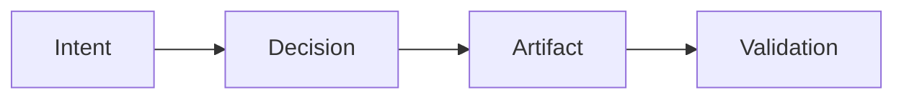

# 3. Normative Core Rules (Draft)

These rules are normative constraints and obligations of the method.
Each rule is stated to be verifiable, to imply consequences when violated, and to support analysis without dependence on tooling.
They are independent of workflow sequencing and do not prescribe a process.

## 3.0 How to Read These Rules
These rules constrain outcomes, not activity order. A team may satisfy them through different workflows and still be compliant, because the method evaluates what exists and how it is justified, not when it was produced.

Missing artifacts are allowed only through explicit compensation. Compensation is an auditable act that records accepted risk; it does not remove the underlying obligation.

Violations are diagnosable conditions, not moral failures. The intent is to make gaps observable and explainable so they can be corrected or accepted explicitly.

### 3.0.1 Normative Keywords
The keywords MUST, MUST NOT, SHOULD and MAY are interpreted as described in BCP 14 [RFC 2119; RFC 8174] when, and only when, they appear in capitals. In the Spanish edition they correspond to DEBE, NO DEBE, DEBERÍA and PUEDE. A SHOULD is a recommendation: departing from it is not a violation, but the reason for departing should be explicit.

### 3.0.2 Terms Used by All Rules
The following terms fix what the rules apply to. They are defined precisely in chapters 7 and 8; the summary here is sufficient to read the rules.

- **Method application.** The use of the method on a declared *evaluated scope*: a system boundary, a set of engineering changes, the evidence sources considered, and a declared *parameter set*. Every rule is evaluated within a method application; outside it, the rules make no claim.
- **Engineering change.** A modification of behavior-affecting artifacts within the evaluated scope, identified by a version delta (for example a commit range, a merge request, a model revision or a configuration change). The *change unit* (what counts as one change) is declared by the application, not prescribed by the method.
- **Engineering record.** The set of intents, decisions, assumptions, trade-offs, validations, compensations and links that exist in the declared evidence sources. Records are typed by their role, not by their storage: a decision written in a Markdown file is a decision, not an artifact.
- **Obligation instance.** A rule applied to one subject, written ⟨rule, subject⟩, for example ⟨R4, payment-adapter v2.3⟩. Evaluation produces one outcome per obligation instance.
- **Policy.** A criterion in the parameter set that decides a parameter-dependent predicate: which changes are non-trivial, which decisions are impactful, which artifacts affect behavior, which elements are critical, which validation is adequate, which compensations are admissible and who may accept risk. Rules refer to these predicates; the parameter set gives them meaning in a context.

### 3.0.3 Outcomes
Evaluating an obligation instance yields exactly one of five outcomes: *satisfied*, *violated*, *compensated*, *not applicable* or *indeterminate*. *Compensated* is not a form of *satisfied*: the obligation remains, and the outcome records that it is unmet under an accepted risk. *Indeterminate* means that the available evidence does not decide the question; it is not a violation and it is not compliance. Chapter 7.5 defines the outcomes formally and chapter 8.7 explains how they are reported.

### 3.0.4 Status of the Text
Each rule below keeps the normative statement of version 0.2.1. The paragraphs headed *Precision* make the existing statement evaluable without changing what it requires. Paragraphs headed *Proposed interpretation (OD-n)* would change or settle the meaning of a rule. They are pending a decision by the maintainer and are recorded, with alternatives, in `docs/open-decisions.md`. Until a decision is made, an evaluator MUST state in the evaluation which proposed interpretations it applied.

## 3.1 Rule 1 - Intent Declaration (Mandatory)
Every non-trivial engineering change MUST declare an explicit Intent.
Intent defines the desired outcome, property, or constraint the change aims to satisfy.
Intent MUST have a defined scope.
Changes without declared intent are considered implicit work.

This rule ensures that changes are anchored to a stated objective and can be evaluated against it, regardless of whether the work begins from code or from models.

Example: A team modifies caching behavior with the intent to reduce latency for a defined service boundary, and records that scope explicitly.

Rationale:
Without intent, no validation or traceability is possible. Quality becomes accidental.

**Precision.**
*Subject:* each engineering change in the evaluated scope.
*Applies when:* the change is non-trivial under the triviality policy of the parameter set. If no triviality policy is declared, applicability is undetermined and the outcome is *indeterminate* unless the requirement is met; under OD-9, Rule 7 is also violated.
*Satisfied when:* the change is linked to at least one intent record whose scope is stated (the part of the system, the stakeholders or the quality attribute concerned).
*Evidence:* the intent record and the link from the change to it, in a declared evidence source. When the intent was recorded does not matter for this rule; an intent written after the code is valid (chapter 9, Scenario A).
*Formal counterpart:* 7.3, R1.

**Proposed interpretation (OD-5).** Rule 1 is not compensable. A compensation must state which risk is accepted, which cannot be done without stating what the change was meant to achieve, and stating that is declaring the intent.

## 3.2 Rule 2 - Decision Explicitness (Mandatory)
Every irreversible or impactful engineering decision MUST be made explicit.
A Decision MUST reference:
- the Intent it serves
- the alternatives considered (at least implicitly)
Undocumented decisions are treated as assumptions by default.

This rule preserves rationale and ensures that impactful choices can be reviewed after the fact, even when those choices are made under time pressure.

Example: Under a production deadline, a team selects a simpler data model and records the decision along with the alternative that was rejected for risk reasons.

Rationale:
Undocumented decisions prevent post-failure analysis and learning.

This diagram shows the minimal trace chain the rules expect: intent informs decisions, decisions shape artifacts, and validation ties artifacts back to their intended purpose.

**Precision.**
*Subject:* each engineering choice embodied in the evaluated scope, whether or not it was recorded. Recorded decisions are found in the record. Unrecorded decisions are identified by review or by failure analysis as choices embodied in artifacts (a data model, a timeout value, a dependency) for which no decision record exists.
*Applies when:* the choice is irreversible or impactful under the impact policy.
*Satisfied when:* a decision record exists, it is linked to the intent it serves, and it references the alternatives considered.
*Evidence:* the decision record and its links. Architecture decision records [Tyree and Akerman 2005] are one common form. An unrecorded decision can only be *violated*, *compensated* or *indeterminate*; it is never *satisfied*.
*Formal counterpart:* 7.3, R2.

**Proposed interpretation (OD-2).** "Treated as assumptions by default" is a diagnostic classification. During evaluation and failure analysis, an unrecorded decision is treated as an unvalidated premise, not as a reviewed choice. The classification does not discharge Rule 2: the obligation instance remains *violated* unless it is compensated.

**Proposed interpretation (OD-3).** "The alternatives considered (at least implicitly)" means that the record either lists the alternatives considered or states explicitly that no alternative was evaluated and why. An alternative cannot be referenced implicitly by an explicit record.

**Proposed interpretation (OD-4).** When an impactful decision balances competing quality attributes or constraints, the decision record MUST state the trade-off accepted (what was given up, for what). Trade-offs are therefore governed as part of Rule 2, not by a separate rule.

## 3.3 Rule 3 - Artifact Traceability (Mandatory)
Every Artifact that affects system behavior MUST be traceable to at least one Intent or Decision.
Orphan artifacts are considered unjustified artifacts.
Traceability MUST be navigable in both directions.

This rule ensures that artifacts exist for a reason that can be located and reviewed, rather than surviving as unexplained residue of past work.

Example: A new configuration flag is linked to the decision that introduced it and the intent it was meant to satisfy.

Rationale:
Untraceable artifacts increase complexity without accountable value.

**Precision.**
*Subject:* each artifact version in the evaluated scope. An *artifact* is any versioned work product. Rule 3 applies to the subset that affects system behavior under the behavior-affecting policy, which typically includes source code, configuration, schemas, infrastructure definitions and models used to generate or configure the system.
*Satisfied when:* a trace path exists from the artifact to at least one intent or decision. The path may pass through other records or artifacts (for example generated code → model → decision → intent). A direct link is a special case.
*Bidirectional navigability* is a requirement on how links are recorded, not on the graph, because any recorded relation can be read in both directions. A link satisfies it when, using only the declared evidence sources, one can find the justification from the artifact and the justified artifacts from the intent or decision (chapter 8.4).
*Formal counterpart:* 7.3, R3.

## 3.4 Rule 4 - Validation Requirement (Contextual)
Artifacts and Decisions with critical impact MUST have explicit Validation.
What is considered critical is a method parameter, not a fixed threshold.
Validation MAY take different forms:
- tests
- reviews
- proofs
- simulations
- external evidence

This rule ties validation effort to contextual criticality, allowing different forms of evidence while still requiring explicit justification for high-impact work.

Example: A high-risk change in a payment flow is validated through a targeted review and test evidence appropriate to its criticality.

Rationale:
Critical work without validation is indistinguishable from speculation.

**Precision.**
*Subject:* each artifact version and each decision in the evaluated scope (OD-12).
*Applies when:* the subject is critical under the criticality policy.
*Satisfied when:* a validation record exists that (a) refers to the same version of the subject, or to a version the record declares equivalent, and (b) is adequate under the validation-adequacy policy (for example, the kinds of validation required for a criticality level). A validation of version 1.4.0 does not validate version 1.4.1.
*Evidence:* the validation record, its result, the version it examined, and when adequacy requires judgment, who assessed it.
*Formal counterpart:* 7.3, R4.

## 3.5 Rule 5 - Assumption Declaration (Mandatory)
Assumptions MUST be explicitly declared when evidence is missing or deferred.
Assumptions MUST be identifiable as such.
Assumptions SHOULD be tracked until validated or invalidated.

This rule makes uncertainty visible and prevents hidden premises from becoming silent dependencies in the system.

Example: A team assumes an external dependency will sustain a defined throughput until benchmarks can be run, and records that assumption explicitly.

Rationale:
Implicit assumptions silently accumulate risk.

**Precision.**
*Subject:* each decision or artifact in the evaluated scope that relies on a premise not supported by evidence in the record.
*Satisfied when:* each such premise is recorded as an assumption, typed as such, and linked to the elements that rely on it. Tracking (SHOULD) means the assumption has a status (*open*, *validated*, *invalidated*), and the record shows when the status changed.
*Detectability.* A hidden premise is, by definition, not in the record. In general, violations of Rule 5 cannot be found by inspecting the record mechanically. They are established by review or by failure analysis, when a premise relied upon is identified and found to be neither validated nor declared. Mechanical checks cover only the declared part: typing, links and status. Under the proposed interpretation of OD-1 (3.8), such a finding counts only when the review or the analysis has established that the element relied on the premise. A suspected premise makes the instance *indeterminate*, not *violated*.
*Relation to Rule 6.* An assumption records what is believed. A compensation records which obligation is unmet and which risk is accepted. The two are complementary: a critical artifact released without validation on the premise that a dependency behaves as documented needs both a declared assumption (Rule 5) and a compensation for the missing validation (Rule 6). A declared assumption that later proves false is not a violation of Rule 5; it is the rule working.
*Formal counterpart:* 7.3, R5.

**Proposed interpretation (OD-5).** Rule 5 is not compensable. Its minimum obligation is to identify and declare the premise: record it as an assumption and link it to the elements that rely on it. Accepting a risk cannot replace that obligation, because only a premise that has been declared can be the object of an accepted risk. A compensation whose risk statement mentions a premise does not declare it; the premise is declared only when it is recorded as an assumption. What can be deferred, and compensated, is the *evidence* for a declared assumption:

- Rule 5 does not require the evidence. A declared assumption is the record that evidence is missing or deferred, and an open, declared assumption satisfies Rule 5.
- When the context requires evidence for the premise, because a critical element relies on it, the requirement belongs to Rule 4. The validation-adequacy policy MAY require that the premises a critical subject relies on are validated. A missing validation of that kind is a gap in the Rule 4 instance of that subject, and Rule 6 applies to it: the compensation references that instance and the declared assumption.
- Tracking the status of an assumption remains a recommendation (SHOULD). Not tracking it produces a note, not an outcome.

As a result, an undeclared premise that an element is established to rely on leaves the Rule 5 instance *violated*, whatever compensations exist. A declared but unvalidated premise satisfies Rule 5; if the context requires evidence for it, that evidence gap is *compensated* or *violated* under Rule 4.

## 3.6 Rule 6 - Explicit Compensation (Mandatory)
When a required artifact or validation is missing, the absence MUST be explicitly compensated.
Compensation MUST:
- be documented
- reference the missing element
- state the accepted risk

Compensation is an explicit, auditable record of accepted risk. It does not erase the obligation; it marks a conscious deviation and allows evaluation of its impact.

Example: A hotfix is deployed without full validation, and the team records the missing validation, the accepted risk, and the follow-up plan.

Rationale:
Shortcuts are allowed; silent shortcuts are not.

**Precision.**
*Subject:* each obligation instance of the other rules that applies and is not met. Rule 6 is a rule about the outcomes of other rules. "Reference the missing element" means referencing the unmet obligation instance (the rule and the existing subject), because a missing element cannot itself be referenced.
*Satisfied when:* a compensation record references the obligation instance, states the accepted risk, and is valid at evaluation time (see below). The outcome of the referenced instance is then *compensated*, never *satisfied*. Remediation (producing the missing record) turns the instance into *satisfied* for the versions it covers and closes the compensation.
*Validity.* A compensation is valid when it is admissible for that obligation under the parameter set, is accepted by a party the authority policy allows to accept that risk, and has not expired. A compensation that is not valid leaves the instance *violated*. It does not by itself create a second violation.

**Proposed interpretation (OD-5).** Compensable rules are R2, R3 and R4. R1, R5 and R7 are not compensable; R6 and R8 are not subject to compensation. For Rule 5 the obligation is the declaration itself; evidence gaps associated with a declared assumption are compensated under Rule 4 (3.5). Parameters MAY declare further obligations non-compensable in a context.

**Proposed interpretation (OD-6).** A compensation MUST declare a review condition: an expiry date or an event, such as "until the integration test suite runs green". It MAY be open-ended only if the parameter set allows permanent acceptance for that kind of obligation. A compensation recorded after the exposure it covers (for example after a failure) is flagged as *retroactive*. It counts for evaluations after it was recorded, but is not evidence that the risk was accepted before the exposure.

**Proposed interpretation (OD-7).** The parameter set MUST declare who may accept which risks, and each compensation MUST identify the accepting party. The method does not prescribe roles or require independence; parameters may require it, for example by forbidding the author of a critical change from accepting its risk.

*Formal counterpart:* 7.4 and 7.5.

## 3.7 Rule 7 - Parameter Awareness (Mandatory)
The method MUST be applied with explicit contextual parameters.
Examples of parameters:
- domain criticality
- risk tolerance
- regulatory pressure
- team scale
- expected lifespan of the system

These parameters influence:
- required explicitness level
- validation depth
- acceptable compensations

This rule ensures that obligations are applied with context, so evaluation reflects the actual risk and criticality of the work.

Example: A system in a regulated domain declares higher validation depth and stricter compensation limits than an internal prototype.

Rationale:
Quality is contextual; rigor without context is waste.

**Precision.**
*Subject:* the method application, not individual changes. There is one obligation instance of Rule 7 per evaluated scope.
*Satisfied when:* the parameter set is explicit, versioned, and bound to the evaluation.
Parameters act in two layers. *Context descriptors*, such as those listed above, characterize the situation. *Policies* decide the predicates that the other rules use. Parameters shape applicability, adequacy and admissibility; they cannot turn an applicable, unmet obligation into a satisfied one.

**Proposed interpretation (OD-9).** Rule 7 is satisfied only if the parameter set declares a policy for each parameter-dependent predicate: change unit and triviality, impact and irreversibility, behavior-affecting artifact, criticality, validation adequacy, compensation admissibility and risk-acceptance authority. A policy is a criterion; it need not be a numeric threshold. A missing policy makes every outcome that depends on it *indeterminate*.

*Formal counterpart:* 7.2.4 and 7.3, R7.

## 3.8 Rule 8 - Diagnosability of Failure (Outcome Rule)
When failure occurs, it MUST be possible to explain it in terms of method application.
At least one of the following MUST be identifiable:
- missing intent
- invalid decision
- unvalidated artifact
- false assumption
- inadequate compensation
- misconfigured parameters

This rule makes failure a traceable outcome of engineering choices, not a retrospective narrative. It enables analysis of which obligation was not met and why.

Example: After an outage, the analysis identifies an unvalidated artifact and a missing compensation record as the decisive gap.

Rationale:
If failure cannot be explained in method terms, the method was not applied.

**Precision.**
*Subject:* each failure observed within the evaluated scope.
Rule 8 is evaluated after the fact and depends on a causal analysis of the failure (incident analysis, debugging, root-cause investigation), which the method does not perform. The method relates the causal factors identified by that analysis to the engineering record. It does not identify causes by itself.
The six reasons listed are of different kinds. *Missing intent*, *unvalidated artifact* and *inadequate compensation* are gaps in obligations. *False assumption* is usually a declared premise that proved wrong, which is the method working. *Invalid decision* and *misconfigured parameters* are judgments made with hindsight and must be supported by the record available at the time of the decision.

**Proposed interpretation (OD-1).** Rule 8 obliges the engineering record to be sufficient to relate each established causal factor of a failure within the evaluated scope to the record. It distinguishes two situations that the 0.2.1 text does not:

- *A missing engineering-context relationship.* The causal analysis has established the factor and where it acts, that place lies within the evaluated scope, and the record, declared complete for that part of the scope, contains no element the factor can be related to. The behavior involved was shaped outside the engineering record. This situation, and only this one, violates Rule 8.
- *Causal uncertainty or incomplete investigation.* The factor is still a hypothesis, where it acts is not yet known, the investigation has not declared its set of factors final, or the relation cannot be checked because the evidence is inaccessible or not declared complete. These are limits of the analysis or of access to evidence, not findings about the record. They make the outcome *indeterminate*.

Each established factor whose place of action is known is classified into one of five classes:
1. a method-level gap (a *violated* obligation instance, or a compensation that was invalid);
2. a realized accepted risk (a valid compensation or a declared assumption);
3. a parameter misclassification (a policy that classified the element as trivial, non-critical or compensable, with consequences outside the declared risk tolerance);
4. an external or out-of-scope factor;
5. unrelated, that is, a missing engineering-context relationship as defined above (for example a production setting changed outside version control).

A factor that cannot yet be classified is *unresolved*. Rule 8 is violated only by factors in class 5. It is satisfied when the investigation has declared its set of factors final and every factor in it is in classes 1 to 4. Otherwise it is *indeterminate*. Rule 8 is not violated by external factors, realized accepted risks or unresolved factors.

The failure analysis does not create violations of other rules. A factor of class 1 points to an instance that was already *violated* when evaluated on the record as it stood before the failure (7.7). A factor that cannot yet be reliably related to the record makes no obligation instance *violated*, under Rule 8 or under any other rule; in particular, an unresolved factor is not a gap. When the analysis contributes new evidence, for example that a change relied on an undeclared premise, that evidence enters the evaluation as a recorded judgment and is evaluated like any other record.

Under this interpretation the rationale above reads: *if an established failure factor cannot be related to the engineering record, the record was insufficient*. The current text says that the method was not applied, which chapter 6.6 contradicts for external and irreducible failures.

*Formal counterpart:* 7.7.

## 3.9 Meta-Note
These rules do not describe a process.
They define constraints and obligations that must hold regardless of workflow.
That is what makes them rules of a method, not of a process.

## 3.10 Conclusion
These rules make evaluation possible by specifying what must be explicit and how gaps are recorded. They transform failure into evidence by making missing intent, decisions, assumptions, validation, or compensation observable. Because they constrain outcomes rather than activity order, they remain independent of any specific process.
