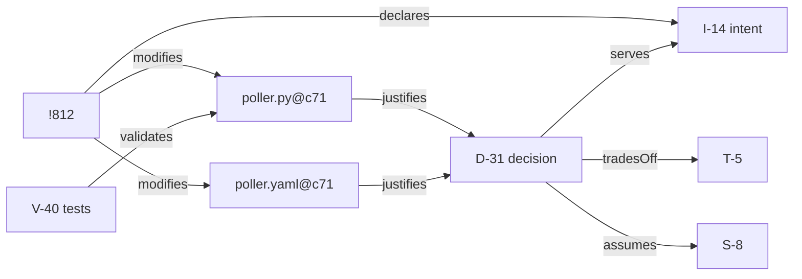
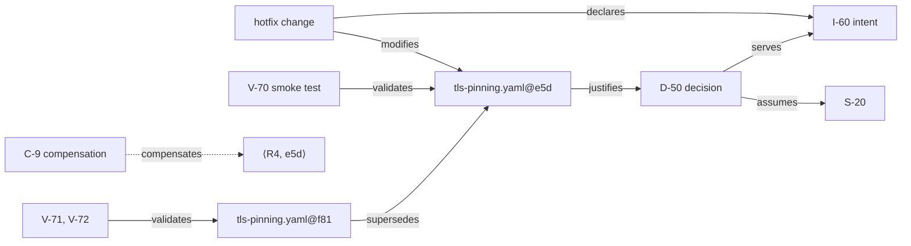
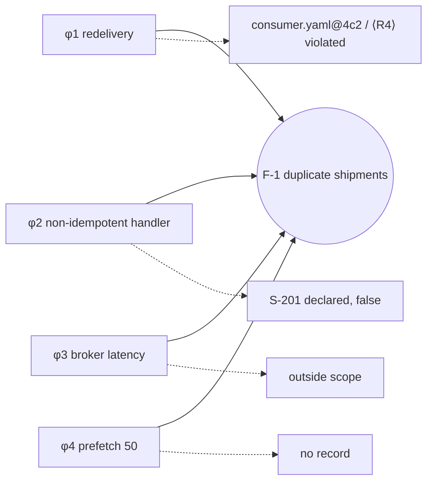

# 9. Worked Examples

This chapter applies the rules (chapter 3), the evaluation semantics (chapter 7) and the evaluation contract (chapter 8) to five scenarios. The scenarios are constructed for illustration; they are not case studies, and no empirical claim follows from them. The systems, people and identifiers are fictional.

Each scenario lists the context, the records (entities), the relevant relations, the obligation instances with their expected outcomes, and an explanation. The examples apply the recommended alternatives of the open decisions (`docs/open-decisions.md`). Where a different alternative would change an outcome, the scenario says so.

Identifiers: `I-` intent, `D-` decision, `S-` assumption, `T-` trade-off, `V-` validation, `C-` compensation, `F-` failure. Artifact versions are written `path@revision`.

---

## 9.1 Scenario A - Code-First Change

**Context.** A shop platform. The component `orders-api` polls a payment provider for the status of pending payments. Under peak load the provider starts answering HTTP 429 (too many requests). A developer, Ana, changes the poller first and writes the explanation afterwards.

**Parameter set PS-shop v7 (excerpt).**
*Change unit:* merge request. *Trivial:* changes limited to comments, formatting or renames with no behavior change. *Impactful:* affects a public API, a persisted data format, a security control, or the interaction with an external dependency. *Critical:* code or configuration that can change monetary state (capture, refund) or authentication. *Completeness:* merge request descriptions and the linked decision log are declared complete for intents and decisions of merge requests on `main`; CI is complete for validations on `main`.

**What happened, in order.**
1. Ana changes `poller.py` and `poller.yaml` (exponential backoff with jitter, maximum delay 30 s) and runs the tests locally.
2. She opens merge request !812. Only then does she write the description: the intent, the decision, the rejected alternatives, the trade-off and an assumption.
3. In a separate merge request, !813, she renames a local variable.

**Records.**

| Id | Type | Content | Provenance |
|---|---|---|---|
| I-14 | intent | Reduce 429 responses from provider P during peaks. Scope: payment-status poller of `orders-api`. | retrospective |
| D-31 | decision | Exponential backoff with jitter, capped at 30 s. Alternatives: fixed delay (still produces bursts); provider webhooks (not available in the current contract tier). | retrospective |
| T-5 | trade-off | Status updates may arrive up to 30 s later during peaks, in exchange for staying within the rate limit. | retrospective |
| S-8 | assumption | Peak polling demand will not exceed 3x the current demand. Status: open. | retrospective |
| V-40 | validation | Unit tests of the backoff schedule, passed at `c71`. | contemporaneous |

**Outcomes.**

| Instance | Outcome | Explanation |
|---|---|---|
| ⟨R1, !812⟩ | satisfied | I-14 declared and scoped. It was written after the code, which does not matter (Proposition 7.7). |
| ⟨R1, !813⟩ | not applicable | Rename only: trivial under the triviality policy. |
| ⟨R2, D-31⟩ | satisfied | Impactful (external dependency). Serves I-14, alternatives recorded, trade-off T-5 recorded. |
| ⟨R3, poller.py@c71⟩ | satisfied | Path `poller.py → D-31 → I-14`. |
| ⟨R3, poller.yaml@c71⟩ | satisfied | Path `poller.yaml → D-31 → I-14`. |
| ⟨R4, poller.py@c71⟩, ⟨R4, D-31⟩ | not applicable | Read-only status polling is not critical under PS-shop. V-40 exists but is not required. |
| ⟨R5, S-8⟩ | satisfied | Declared and linked to D-31. Status tracked as open. |
| ⟨R7, α⟩ | satisfied | PS-shop v7 is explicit, versioned and covers all policies. |

**Verdict:** compliant.

**Explanation.** The rules ask what exists, not in which order it was produced. Ana started from code, and the obligations were the same as if she had started from a design note. What the method does record is provenance: I-14 and D-31 are *retrospective*, written by the person who did the work. This is valid evidence and is distinguishable from a reconstruction by someone else.

**Counterfactual.** Suppose Ana had merged !812 with the description "fix polling". Then ⟨R1, !812⟩ is *violated*: the change is non-trivial, no intent exists, and merge request descriptions are declared complete. A reviewer identifies the backoff strategy as an unrecorded impactful choice $d^*$, so ⟨R2, $d^*$⟩ is *violated*. In diagnosis, $d^*$ is treated as an unvalidated premise (OD-2). ⟨R3, poller.py@c71⟩ is *violated*: there is no justification path. If the completeness declaration for merge request descriptions were removed, the same three instances would be *indeterminate*: the evaluator could no longer tell that the records do not exist somewhere else.

---

## 9.2 Scenario B - Model-First Development

**Context.** A hospital information system. A module computes weight-based pediatric doses. Work proceeds from requirements to a decision table model; code is generated from the model.

**Parameter set PS-clinic v3 (excerpt).**
*Change unit:* model revision or merge request. *Behavior-affecting:* includes models used for code generation. *Critical:* any artifact or decision that can change a computed dose. *Adequacy for critical artifacts:* models are reviewed by a clinical pharmacist; generated code passes tests derived from the requirement examples. *Admissibility:* missing validation of dose computations is **not compensable**. *Authority:* clinical safety officer.

**Records.**

| Id | Type | Content | Provenance |
|---|---|---|---|
| I-3 | intent | Compute pediatric doses by weight band without exceeding the maximum dose. Scope: dosing module, pediatric ward. Derived from requirement REQ-7. | contemporaneous |
| D-7 | decision | Round down to the nearest dispensable unit. Alternatives: round to nearest (can exceed the maximum); exact dose (not dispensable). | contemporaneous |
| T-2 | trade-off | Possible under-dosing by up to one dispensable unit, in exchange for never exceeding the maximum. | contemporaneous |
| S-3 | assumption | Weight is entered in kilograms (the form enforces the unit). Status: validated by V-15. | contemporaneous |
| V-11 | validation | Pharmacist review of `dosing.dmn@r12`, passed. | contemporaneous |
| V-12 | validation | Requirement-derived tests on `dosing_gen.py@1.4.0`, passed. | contemporaneous |
| V-14 | validation | Requirement-derived tests on `dosing_gen.py@1.4.1`, passed. | contemporaneous |
| V-15 | validation | UI test confirming the unit is enforced, passed. | contemporaneous |

Relations: `dosing.dmn@r12 → D-7 → I-3` (justifies, serves). `dosing_gen.py@1.4.0` is derived from `dosing.dmn@r12`. Revision `r13` of the model changes two weight-band boundaries and produces `dosing_gen.py@1.4.1`; `dosing.dmn@r13` justifies D-7.

**Outcomes at baseline 1.4.0.** Every applicable instance is *satisfied*: ⟨R1⟩ for the model revision and the generation change; ⟨R2, D-7⟩; ⟨R3⟩ for the model and the generated code (the code's path runs through `derivedFrom`); ⟨R4⟩ for the model (V-11), the generated code (V-12) and D-7 (V-11 covers the decision table that embodies it); ⟨R5, S-3⟩. **Verdict:** compliant.

**Outcomes at baseline 1.4.1.**

| Instance | Outcome | Explanation |
|---|---|---|
| ⟨R4, dosing_gen.py@1.4.1⟩ | satisfied | V-14 validates this version and is adequate for generated code. |
| ⟨R4, dosing.dmn@r13⟩ | violated | Critical. V-11 validated `r12`, not `r13`, and no equivalence is declared: the boundaries changed. Adequacy requires a pharmacist review. |
| ⟨R3, dosing.dmn@r13⟩ | satisfied | Path `r13 → D-7 → I-3`. |

If the team records a compensation for ⟨R4, dosing.dmn@r13⟩, it is *not valid*: PS-clinic declares the obligation non-compensable. The outcome stays *violated*. **Verdict:** non-compliant.

**Explanation.** The obligations are the ones of Scenario A: intent, decision, traceability, validation. Here they were met in another order, before implementation. The model-first workflow does not earn compliance by itself. A model revision is a new version, and its validation does not carry over from the previous revision. The parameter set, not the workflow, is what makes this context stricter: it requires a specific kind of validation and forbids compensation.

---

## 9.3 Scenario C - Emergency Production Change

**Context.** `payment-adapter` pins the TLS certificate of payment provider P. At 02:05 on 14 October, P rotates its certificate; every authorization fails. Incident INC-77 is declared at 02:12.

**Parameter set PS-shop v7 (excerpt).**
*Critical:* the adapter's TLS configuration is critical (payments and security). *Adequacy:* integration tests against P's sandbox and a security review. *Admissibility:* compensable; permanent acceptance not permitted. *Authority:* during a declared incident, the incident commander may accept risks on critical artifacts for at most 72 hours. Beyond that, only the security officer may. *Completeness:* as in Scenario A; in addition, security reviews and compensations are recorded in the review tool and the decision log, both declared complete.

**Records.**

| Id | Type | Content | Recorded |
|---|---|---|---|
| I-60 | intent | Restore authorizations through P during INC-77. Scope: outbound TLS from `payment-adapter` to P. | 14 Oct 02:20 |
| D-50 | decision | Temporarily disable pinning for P, keeping standard CA validation. Alternatives: pin the new certificate (its fingerprint was not yet available through a trusted channel); fail over to provider Q (insufficient capacity). | 14 Oct 02:24 |
| S-20 | assumption | The certificate authorities trusted by the platform are not compromised for P's domain. Status: open. | 14 Oct 02:31 |
| V-70 | validation | Production smoke test: one authorization succeeded. Passed, but not adequate. | 14 Oct 02:41 |
| C-9 | compensation | Covers ⟨R4, tls-pinning.yaml@e5d⟩. Risk: man-in-the-middle exposure for traffic to P limited by standard CA trust; low likelihood, high impact. Accepted by the incident commander. Review condition: 17 Oct 02:38 (72 h) or restoration of pinning. Plan: pin set with backup pins, integration tests, security review. | 14 Oct 02:31 |
| V-71, V-72 | validation | Integration tests and security review of `tls-pinning.yaml@f81`, passed. | 19 Oct 11:00 |

The hotfix `tls-pinning.yaml@e5d` is deployed at 02:38 on 14 October. The remediation `tls-pinning.yaml@f81`, which restores pinning with backup pins, is deployed at 11:00 on 19 October and supersedes `e5d`.

**Outcomes over time.**

| Instance | t1 = 15 Oct 10:00 | t2 = 18 Oct 09:00 | t3 = 20 Oct 09:00 |
|---|---|---|---|
| ⟨R1, hotfix⟩ | satisfied | satisfied | satisfied |
| ⟨R2, D-50⟩ | satisfied | satisfied | satisfied |
| ⟨R3, e5d⟩ | satisfied | satisfied | satisfied |
| ⟨R4, e5d⟩ | **compensated** (C-9 valid) | **violated** (C-9 expired; `e5d` still in operation) | **violated** (C-9 expired at 17 Oct 02:38, before `e5d` left operation on 19 Oct 11:00) |
| ⟨R5, S-20⟩ | satisfied | satisfied | satisfied |
| ⟨R4, f81⟩ | — | — | satisfied |
| **Verdict** | compliant with compensations | non-compliant | non-compliant |

**Explanation.** The shortcut was allowed, and it was not silent. At t1 the record shows exactly which obligation was unmet, which risk was accepted, by whom, until when, and on the basis of which assumption. Compensation did not turn the obligation into a satisfied one. When C-9 expired, the instance became *violated* again; the obligation had not gone anywhere.

S-20 shows the division proposed in OD-5. The premise that the trusted certificate authorities are not compromised is declared, so ⟨R5, S-20⟩ is *satisfied* throughout; C-9 could not have replaced that declaration. What C-9 accepts is the missing validation of `e5d`, an instance of Rule 4, on the basis of the declared premise.

At t3 the remediation is in place and `f81` is satisfied. The historical instance for `e5d` remains *violated*, because between 17 Oct 02:38 and 19 Oct 11:00 a critical artifact was in operation without validation or a valid compensation. Two alternative courses would have kept ⟨R4, e5d⟩ *compensated* at t3. One is to deploy the remediation before 17 Oct 02:38 (Definition 7.13 evaluates validity at the end of the subject's exposure). The other is for the security officer to renew the acceptance before expiry, with a new compensation that supersedes C-9.

**Variant (retroactive compensation).** Suppose C-9 had been written on 16 October, after the hotfix had been in operation for two days. It would be flagged as *retroactive* (OD-6). It counts from 16 October onward. If a failure caused by the disabled pinning had occurred on 15 October, C-9 could not place that factor in the *accepted risk* class (7.7).

---

## 9.4 Scenario D - Legacy Software

**Context.** `stockd`, a twelve-year-old warehouse application. Its history before 2019 was lost in a repository migration; there are no design documents. The team adopts the method at tag `adopt-esem` on 2 March 2026.

**Parameter set PS-stockd v1 (excerpt).**
*Adoption boundary:* `adopt-esem`. Inherited artifacts produce obligation instances when a change modifies them, or when they are critical. *Critical:* reservation and allocation logic. *Adequacy:* characterization tests of existing behavior plus tests of the change, and a review. *Completeness:* repository and CI are complete from 2024; nothing is declared complete for earlier history. *Authority:* the product owner may accept risks on inherited artifacts for at most six months.

**The change.** Change ch-112 fixes a leak: reservations of cancelled orders are not released. It modifies `reservation.php`, which also contains `RESERVATION_TTL = 47` (minutes), an inherited constant whose rationale nobody knows. A code-analysis assistant suggests that "47 minutes matches a carrier pickup window". The warehouse supervisor says batch picking runs about every 45 minutes but cannot confirm the connection.

**Records.**

| Id | Type | Content | Provenance |
|---|---|---|---|
| I-90 | intent | Release reservations of cancelled orders immediately. Scope: reservation module. | contemporaneous |
| I-91 | intent | Preserve the existing reservation expiry behavior until its purpose is established. Scope: reservation module. | contemporaneous |
| D-91 | decision | Keep `RESERVATION_TTL = 47` unchanged. Alternatives: change it to 60 (rejected: unknown dependants); remove expiry (rejected). Serves I-91. | contemporaneous |
| S-30 | assumption | Some downstream process, possibly batch picking, depends on reservations expiring after roughly 47 minutes. Status: open. | contemporaneous |
| X-1 | inferred link | "47 minutes matches a carrier pickup window". Proposed by the code-analysis assistant; not confirmed. | inferred |
| V-60 | validation | Characterization tests recording the current expiry behavior, passed. | contemporaneous |
| V-61, V-62 | validation | Tests of the fix and a review of `reservation.php@ch-112`, passed. | contemporaneous |
| C-30 | compensation | Covers ⟨R4, picking.php@adopt-esem⟩: no validation exists for inherited picking logic. Risk: regressions in allocation go undetected until production. Accepted by the product owner. Review condition: 2 September 2026. | contemporaneous |

**Outcomes (evaluation on 1 August 2026).**

| Instance | Outcome | Explanation |
|---|---|---|
| ⟨R1, ch-112⟩ | satisfied | I-90. |
| ⟨R2, D-91⟩ | satisfied | Impactful (keeps behavior others may depend on); alternatives recorded. |
| ⟨R3, reservation.php@ch-112⟩ | satisfied | Paths to I-90 (the fix) and, through D-91, to I-91 (the constant). |
| ⟨R4, reservation.php@ch-112⟩ | satisfied | V-60, V-61, V-62. |
| ⟨R5, S-30⟩ | satisfied | Declared, linked to D-91, status open. |
| ⟨R3, picking.php@adopt-esem⟩ | indeterminate | Critical inherited artifact. No justification is found, and no completeness is declared for history before 2024: the records may never have existed or may have been lost. |
| ⟨R4, picking.php@adopt-esem⟩ | compensated | No validation exists. C-30 is valid until 2 September. |
| original choice of 47 minutes | — | Not an obligation instance: the choice predates the adoption boundary and the artifact's constant was not changed. Reported as a note: *inherited, rationale unknown*. |

**Verdict:** inconclusive (one indeterminate instance).

**Explanation.** Adoption is partial and the record says so. The team did not invent the history of the 47-minute constant. D-91 and I-91 are today's decision and intent: keep a behavior that is not understood. This is accountable and true. S-30 states the suspected dependency as an assumption, not as a fact.

X-1 is a reasonable hypothesis, but it is *inferred* and unconfirmed, so it satisfies nothing (OD-8). Had someone recorded it as "the original decision", that record would have falsely claimed the authority of a decision. If the supervisor later confirms the dependency from batch-picking logs, S-30 can be validated, and a *reconstructed* decision record can be written. It must be marked as reconstructed, and it applies from then on.

The team could have declared completeness for the lost history. ⟨R3, picking.php⟩ would then be *violated* instead of *indeterminate*. They chose not to claim knowledge of history they do not have. The inconclusive verdict is the correct description of a legacy system at the start of adoption. Progress shows up in the profile over successive evaluations, as indeterminate and compensated instances turn into satisfied ones.

---

## 9.5 Scenario E - Failure Investigation

**Context.** A fulfilment service consumes order messages from a managed message broker. On 3 September 2026, 214 orders are shipped twice (failure F-1).

**Parameter set PS-fulfil v4 (excerpt).**
*Boundary:* fulfilment service, its configuration, and the broker settings of the team's own account. The broker service itself is external. *Critical:* anything that can trigger a shipment. *Adequacy:* changes to message delivery semantics require an integration test that covers redelivery, including the idempotency of the handlers that the change relies on. *Completeness:* repository, CI and decision log (which also holds compensations) are complete since adoption in 2025.

**Records before the failure.**

| Id | Type | Content |
|---|---|---|
| I-201 | intent | Reduce the delay before failed messages are retried. Scope: order consumer. |
| D-201 | decision | Reduce the visibility timeout from 30 s to 10 s. Alternatives: a dead-letter queue with delayed retry (rejected: more infrastructure). |
| S-201 | assumption | The handler `ship_order` is idempotent. Status: open since 20 August. |
| V-201 | validation | Unit test of the configuration parser, passed. Not adequate: no redelivery test. |

Change ch-201 (20 August) produced `consumer.yaml@4c2`. No compensation was recorded.

**Causal factors identified by the incident analysis.** The method does not identify these; it receives them from the analysis.

- φ1: messages were redelivered while still being processed, because the 10 s visibility timeout was shorter than processing time under load (`consumer.yaml@4c2`).
- φ2: `ship_order` is not idempotent, so redelivered messages created second shipments.
- φ3: the broker service had a latency incident that day, which lengthened processing times (provider status page).
- φ4: the broker's prefetch setting for the team's account had been raised from 10 to 50 through the provider's web console on 28 August. No version control or record exists for it; the analysis found it in the provider's audit log.

The investigation record of 10 September marks φ1 to φ4 as *established*, gives the part of the system where each acts, and declares the set of factors final.

**Evaluation at exposure (snapshot of 2 September).**

| Instance | Outcome | Explanation |
|---|---|---|
| ⟨R1, ch-201⟩ | satisfied | I-201. |
| ⟨R2, D-201⟩ | satisfied | Alternatives recorded. |
| ⟨R3, consumer.yaml@4c2⟩ | satisfied | Path to D-201 and I-201. |
| ⟨R4, consumer.yaml@4c2⟩ | violated | Critical; V-201 is not adequate under the adequacy policy; no compensation; CI is complete. |
| ⟨R5, S-201⟩ | satisfied | Declared and linked. Note: a critical change relied on it while it stayed open. |

**Factor classification and Rule 8.**

| Factor | Class | Basis |
|---|---|---|
| φ1 | gap | Linked to ⟨R4, consumer.yaml@4c2⟩, which was *violated* at exposure. |
| φ2 | accepted risk (declared assumption proved false) | S-201 was declared. Rule 5 was met; the premise was wrong. |
| φ3 | external | The broker service is outside the boundary. |
| φ4 | unrelated | The setting is within the boundary (the team's account), but no element of the record relates to it. |

⟨R8, F-1⟩ is **violated** under the proposed interpretation (OD-1), because φ4 cannot be related to the engineering record. Under the 0.2.1 text, Rule 8 would count as satisfied, because an "unvalidated artifact" is identifiable (φ1). That reading would hide that part of the system's behavior was changed outside the record.

**Variant (investigation still open).** On 5 September, before the provider's audit log was obtained, the investigation record listed φ1 to φ3 as established and a fourth factor as *provisional*: "the consumption rate rose on 28 August for an unknown reason". Its locus was undetermined: the cause could lie in the broker service, which is external, or in the team's account, which is in scope. At that point the fourth factor is *unresolved*, and ⟨R8, F-1⟩ is *indeterminate*, not *violated*: what was missing was a finished analysis, not yet a relationship in the record. No other instance changes either. The unexplained rate is not a gap in ⟨R3⟩ or ⟨R4⟩ of any artifact, because nothing yet relates it to one (Proposition 7.8). When the audit log established the console change and placed it in the team's account, the factor became φ4, classifiable as *unrelated*, and ⟨R8, F-1⟩ became *violated*. Had the change been made by the provider, the factor would have been *external*. Once the set of factors was declared final, ⟨R8, F-1⟩ would then have been *satisfied*.

**Explanation.** The diagnosis separates four things that a narrative ("a broker incident caused duplicates") would merge:

- a *supported method-level gap* (φ1): a critical change shipped without the validation its context required;
- a *declared premise that proved false* (φ2): the method worked, because the premise was visible, and the gap lies in relying on it unvalidated for a critical change (φ1), not in Rule 5. Under the proposed interpretation of OD-5, that evidence gap belongs to ⟨R4, consumer.yaml@4c2⟩, whose adequacy policy covers the idempotency the change relied on. A compensation for that instance, referencing S-201, would have been admissible; none was recorded. No compensation could have replaced the declaration of S-201;
- an *external factor* (φ3), which the method neither explains nor needs to;
- a part of the system's behavior *outside the engineering record* (φ4), which is what Rule 8 exists to expose.

The diagnosis does not claim that these four factors are all the causes, that any one of them was sufficient, or that the decision D-201 was wrong given what was known on 20 August. It states what the engineering record supports, what it does not cover, and where the evidence stops.

One question remains open: whether `ship_order` was ever intended to be idempotent. Its design predates adoption, and the old ticket system is archived without access. Any instance about that design is *indeterminate* and is reported as such (8.4.3).

---

## 9.6 Summary of the Scenarios

| Scenario | Shows |
|---|---|
| A, code-first | order independence; retrospective provenance; counterfactual violation versus indeterminate under completeness |
| B, model-first | same obligations in another workflow; validation bound to versions; non-compensable obligations by parameter |
| C, emergency | compensation content, authority, expiry and remediation; obligation not erased; time-scoped validity; retroactive compensation; declared assumption with its evidence gap compensated under Rule 4 |
| D, legacy | adoption boundary; no fabricated history; inferred versus reconstructed records; inconclusive verdict as an honest state |
| E, failure | supported gaps versus declared false premises versus external and unrelated factors; missing relationship versus incomplete investigation; Rule 8 under the 0.2.1 text and the proposed reading |
