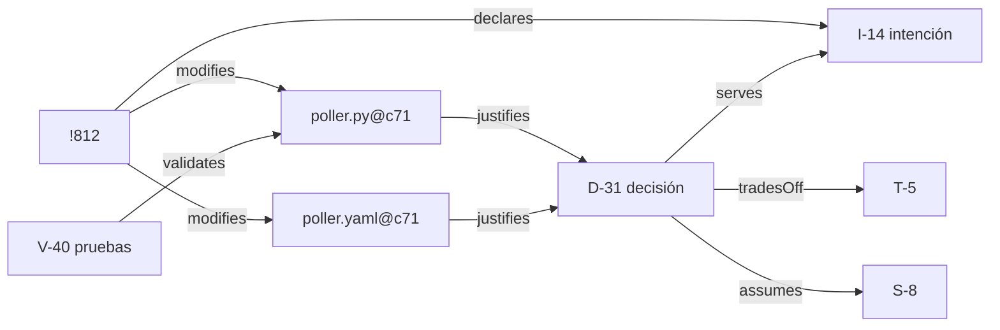
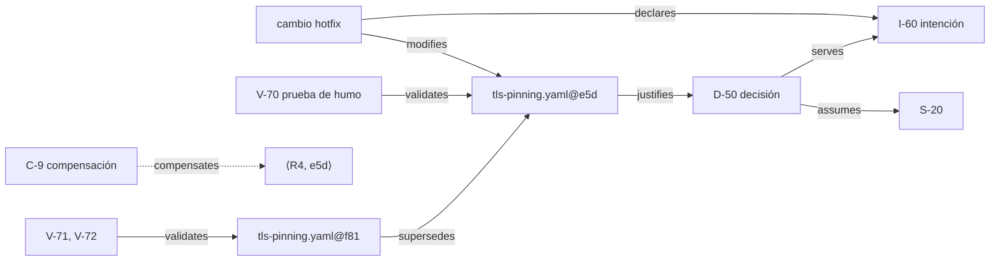
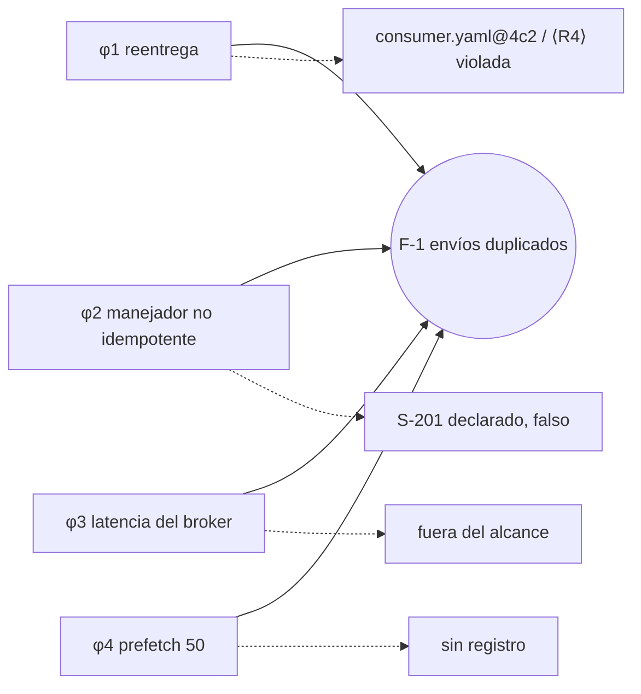

# 9. Ejemplos desarrollados

Este capítulo aplica las reglas (capítulo 3), la semántica de evaluación (capítulo 7) y el contrato de evaluación (capítulo 8) a cinco escenarios. Los escenarios se construyen con fines ilustrativos; no son estudios de caso y de ellos no se sigue ninguna afirmación empírica. Los sistemas, las personas y los identificadores son ficticios.

Cada escenario presenta el contexto, los registros (entidades), las relaciones relevantes, las instancias de obligación con sus resultados esperados y una explicación. Los ejemplos aplican las alternativas recomendadas de las decisiones abiertas (`docs/open-decisions.md`). Cuando otra alternativa cambiaría un resultado, el escenario lo indica.

Identificadores: `I-` intención, `D-` decisión, `S-` supuesto, `T-` trade-off, `V-` validación, `C-` compensación, `F-` fallo. Las versiones de artefactos se escriben `ruta@revisión`.

---

## 9.1 Escenario A - Cambio desde el código

**Contexto.** Una plataforma de comercio. El componente `orders-api` consulta periódicamente a un proveedor de pagos el estado de los pagos pendientes. Bajo carga pico, el proveedor empieza a responder HTTP 429 (demasiadas solicitudes). Una desarrolladora, Ana, modifica primero el sondeo y escribe la explicación después.

**Conjunto de parámetros PS-shop v7 (extracto).**
*Unidad de cambio:* merge request. *Trivial:* cambios limitados a comentarios, formato o renombrados sin cambio de comportamiento. *De impacto:* afecta una API pública, un formato de datos persistido, un control de seguridad o la interacción con una dependencia externa. *Crítico:* código o configuración que puede cambiar estado monetario (captura, reembolso) o la autenticación. *Completitud:* las descripciones de merge requests y el registro de decisiones vinculado se declaran completos para intenciones y decisiones de merge requests en `main`; la CI es completa para validaciones en `main`.

**Qué ocurrió, en orden.**
1. Ana modifica `poller.py` y `poller.yaml` (backoff exponencial con jitter, retardo máximo de 30 s) y ejecuta las pruebas localmente.
2. Abre el merge request !812. Solo entonces escribe la descripción: la intención, la decisión, las alternativas descartadas, el trade-off y un supuesto.
3. En un merge request separado, !813, renombra una variable local.

**Registros.**

| Id | Tipo | Contenido | Procedencia |
|---|---|---|---|
| I-14 | intención | Reducir las respuestas 429 del proveedor P durante los picos. Alcance: sondeo de estado de pagos de `orders-api`. | retrospectiva |
| D-31 | decisión | Backoff exponencial con jitter, limitado a 30 s. Alternativas: retardo fijo (sigue produciendo ráfagas); webhooks del proveedor (no disponibles en el nivel de contrato actual). | retrospectiva |
| T-5 | trade-off | Las actualizaciones de estado pueden llegar hasta 30 s más tarde durante los picos, a cambio de mantenerse dentro del límite de tasa. | retrospectiva |
| S-8 | supuesto | La demanda pico de sondeo no superará 3x la demanda actual. Estado: abierto. | retrospectiva |
| V-40 | validación | Pruebas unitarias del calendario de backoff, superadas en `c71`. | contemporánea |

**Resultados.**

| Instancia | Resultado | Explicación |
|---|---|---|
| ⟨R1, !812⟩ | satisfecha | I-14 declarada y con alcance. Se escribió después del código, lo cual no importa (Proposición 7.7). |
| ⟨R1, !813⟩ | no aplicable | Solo un renombrado: trivial según la política de trivialidad. |
| ⟨R2, D-31⟩ | satisfecha | De impacto (dependencia externa). Sirve a I-14, alternativas registradas, trade-off T-5 registrado. |
| ⟨R3, poller.py@c71⟩ | satisfecha | Camino `poller.py → D-31 → I-14`. |
| ⟨R3, poller.yaml@c71⟩ | satisfecha | Camino `poller.yaml → D-31 → I-14`. |
| ⟨R4, poller.py@c71⟩, ⟨R4, D-31⟩ | no aplicable | El sondeo de estado de solo lectura no es crítico según PS-shop. V-40 existe pero no es requerida. |
| ⟨R5, S-8⟩ | satisfecha | Declarado y vinculado a D-31. Estado seguido como abierto. |
| ⟨R7, α⟩ | satisfecha | PS-shop v7 es explícito, versionado y cubre todas las políticas. |

**Veredicto:** conforme.

**Explicación.** Las reglas preguntan qué existe, no en qué orden se produjo. Ana partió del código, y las obligaciones fueron las mismas que si hubiera partido de una nota de diseño. Lo que el método sí registra es la procedencia: I-14 y D-31 son *retrospectivas*, escritas por la persona que hizo el trabajo. Esto es evidencia válida y se distingue de una reconstrucción hecha por otra persona.

**Contrafáctico.** Supóngase que Ana hubiera integrado !812 con la descripción "fix polling". Entonces ⟨R1, !812⟩ está *violada*: el cambio no es trivial, no existe intención y las descripciones de merge requests se declaran completas. Un revisor identifica la estrategia de backoff como una elección de impacto no registrada $d^*$, de modo que ⟨R2, $d^*$⟩ está *violada*. En el diagnóstico, $d^*$ se trata como una premisa no validada (OD-2). ⟨R3, poller.py@c71⟩ está *violada*: no hay camino de justificación. Si se retirara la declaración de completitud para las descripciones de merge requests, las mismas tres instancias serían *indeterminadas*: el evaluador ya no podría saber que los registros no existen en otro lugar.

---

## 9.2 Escenario B - Desarrollo desde modelos

**Contexto.** Un sistema de información hospitalaria. Un módulo calcula dosis pediátricas según el peso. El trabajo avanza desde los requisitos hacia un modelo de tabla de decisión; el código se genera a partir del modelo.

**Conjunto de parámetros PS-clinic v3 (extracto).**
*Unidad de cambio:* revisión del modelo o merge request. *Afecta el comportamiento:* incluye los modelos usados para generar código. *Crítico:* cualquier artefacto o decisión que pueda cambiar una dosis calculada. *Adecuación para artefactos críticos:* los modelos son revisados por un farmacéutico clínico; el código generado supera pruebas derivadas de los ejemplos de los requisitos. *Admisibilidad:* la validación faltante de cálculos de dosis **no es compensable**. *Autoridad:* responsable de seguridad clínica.

**Registros.**

| Id | Tipo | Contenido | Procedencia |
|---|---|---|---|
| I-3 | intención | Calcular dosis pediátricas por banda de peso sin superar la dosis máxima. Alcance: módulo de dosificación, sala de pediatría. Derivada del requisito REQ-7. | contemporánea |
| D-7 | decisión | Redondear hacia abajo a la unidad dispensable más cercana. Alternativas: redondear al más cercano (puede superar el máximo); dosis exacta (no dispensable). | contemporánea |
| T-2 | trade-off | Posible infradosificación de hasta una unidad dispensable, a cambio de no superar nunca el máximo. | contemporánea |
| S-3 | supuesto | El peso se introduce en kilogramos (el formulario impone la unidad). Estado: validado por V-15. | contemporánea |
| V-11 | validación | Revisión farmacéutica de `dosing.dmn@r12`, superada. | contemporánea |
| V-12 | validación | Pruebas derivadas de requisitos sobre `dosing_gen.py@1.4.0`, superadas. | contemporánea |
| V-14 | validación | Pruebas derivadas de requisitos sobre `dosing_gen.py@1.4.1`, superadas. | contemporánea |
| V-15 | validación | Prueba de interfaz que confirma que la unidad se impone, superada. | contemporánea |

Relaciones: `dosing.dmn@r12 → D-7 → I-3` (justifies, serves). `dosing_gen.py@1.4.0` se deriva de `dosing.dmn@r12`. La revisión `r13` del modelo cambia dos límites de banda de peso y produce `dosing_gen.py@1.4.1`; `dosing.dmn@r13` justifica D-7.

**Resultados en la línea base 1.4.0.** Toda instancia aplicable está *satisfecha*: ⟨R1⟩ para la revisión del modelo y el cambio de generación; ⟨R2, D-7⟩; ⟨R3⟩ para el modelo y el código generado (el camino del código pasa por `derivedFrom`); ⟨R4⟩ para el modelo (V-11), el código generado (V-12) y D-7 (V-11 cubre la tabla de decisión que la materializa); ⟨R5, S-3⟩. **Veredicto:** conforme.

**Resultados en la línea base 1.4.1.**

| Instancia | Resultado | Explicación |
|---|---|---|
| ⟨R4, dosing_gen.py@1.4.1⟩ | satisfecha | V-14 valida esta versión y es adecuada para código generado. |
| ⟨R4, dosing.dmn@r13⟩ | violada | Crítico. V-11 validó `r12`, no `r13`, y no se declara equivalencia: los límites cambiaron. La adecuación exige una revisión farmacéutica. |
| ⟨R3, dosing.dmn@r13⟩ | satisfecha | Camino `r13 → D-7 → I-3`. |

Si el equipo registra una compensación para ⟨R4, dosing.dmn@r13⟩, esta *no es válida*: PS-clinic declara la obligación no compensable. El resultado sigue siendo *violada*. **Veredicto:** no conforme.

**Explicación.** Las obligaciones son las del Escenario A: intención, decisión, trazabilidad, validación. Aquí se cumplieron en otro orden, antes de la implementación. El flujo desde modelos no otorga conformidad por sí mismo. Una revisión del modelo es una versión nueva, y su validación no se hereda de la revisión anterior. Lo que hace más estricto este contexto es el conjunto de parámetros, no el flujo de trabajo: exige un tipo concreto de validación y prohíbe la compensación.

---

## 9.3 Escenario C - Cambio de emergencia en producción

**Contexto.** `payment-adapter` fija (pinning) el certificado TLS del proveedor de pagos P. A las 02:05 del 14 de octubre, P rota su certificado; todas las autorizaciones fallan. El incidente INC-77 se declara a las 02:12.

**Conjunto de parámetros PS-shop v7 (extracto).**
*Crítico:* la configuración TLS del adaptador es crítica (pagos y seguridad). *Adecuación:* pruebas de integración contra el entorno de pruebas de P y una revisión de seguridad. *Admisibilidad:* compensable; no se permite la aceptación permanente. *Autoridad:* durante un incidente declarado, el comandante del incidente puede aceptar riesgos sobre artefactos críticos durante un máximo de 72 horas. Más allá de ese plazo, solo puede hacerlo el responsable de seguridad. *Completitud:* como en el Escenario A; además, las revisiones de seguridad y las compensaciones se registran en la herramienta de revisión y en el registro de decisiones, ambos declarados completos.

**Registros.**

| Id | Tipo | Contenido | Registrado |
|---|---|---|---|
| I-60 | intención | Restablecer las autorizaciones a través de P durante INC-77. Alcance: TLS saliente de `payment-adapter` hacia P. | 14 oct 02:20 |
| D-50 | decisión | Desactivar temporalmente el pinning para P, manteniendo la validación estándar por CA. Alternativas: fijar el nuevo certificado (su huella aún no estaba disponible por un canal de confianza); conmutar al proveedor Q (capacidad insuficiente). | 14 oct 02:24 |
| S-20 | supuesto | Las autoridades de certificación en las que confía la plataforma no están comprometidas para el dominio de P. Estado: abierto. | 14 oct 02:31 |
| V-70 | validación | Prueba de humo en producción: una autorización tuvo éxito. Superada, pero no adecuada. | 14 oct 02:41 |
| C-9 | compensación | Cubre ⟨R4, tls-pinning.yaml@e5d⟩. Riesgo: exposición a intermediario (man-in-the-middle) en el tráfico hacia P, limitada por la confianza estándar en CA; probabilidad baja, impacto alto. Aceptada por el comandante del incidente. Condición de revisión: 17 oct 02:38 (72 h) o restablecimiento del pinning. Plan: conjunto de pines con pines de respaldo, pruebas de integración, revisión de seguridad. | 14 oct 02:31 |
| V-71, V-72 | validación | Pruebas de integración y revisión de seguridad de `tls-pinning.yaml@f81`, superadas. | 19 oct 11:00 |

El hotfix `tls-pinning.yaml@e5d` se despliega a las 02:38 del 14 de octubre. La remediación `tls-pinning.yaml@f81`, que restablece el pinning con pines de respaldo, se despliega a las 11:00 del 19 de octubre y sustituye a `e5d`.

**Resultados en el tiempo.**

| Instancia | t1 = 15 oct 10:00 | t2 = 18 oct 09:00 | t3 = 20 oct 09:00 |
|---|---|---|---|
| ⟨R1, hotfix⟩ | satisfecha | satisfecha | satisfecha |
| ⟨R2, D-50⟩ | satisfecha | satisfecha | satisfecha |
| ⟨R3, e5d⟩ | satisfecha | satisfecha | satisfecha |
| ⟨R4, e5d⟩ | **compensada** (C-9 válida) | **violada** (C-9 expirada; `e5d` aún en operación) | **violada** (C-9 expiró el 17 oct 02:38, antes de que `e5d` saliera de operación el 19 oct 11:00) |
| ⟨R5, S-20⟩ | satisfecha | satisfecha | satisfecha |
| ⟨R4, f81⟩ | — | — | satisfecha |
| **Veredicto** | conforme con compensaciones | no conforme | no conforme |

**Explicación.** El atajo estaba permitido y no fue silencioso. En t1 el registro muestra exactamente qué obligación no se cumplía, qué riesgo se aceptó, quién lo aceptó, hasta cuándo y sobre la base de qué supuesto. La compensación no convirtió la obligación en una satisfecha. Cuando C-9 expiró, la instancia volvió a estar *violada*; la obligación no había desaparecido.

S-20 muestra la división que propone OD-5. La premisa de que las autoridades de certificación de confianza no están comprometidas está declarada, así que ⟨R5, S-20⟩ está *satisfecha* en todo momento; C-9 no podría haber sustituido esa declaración. Lo que C-9 acepta es la validación faltante de `e5d`, una instancia de la Regla 4, sobre la base de la premisa declarada.

En t3 la remediación está en su lugar y `f81` está satisfecha. La instancia histórica de `e5d` sigue *violada*, porque entre el 17 oct 02:38 y el 19 oct 11:00 un artefacto crítico estuvo en operación sin validación ni compensación válida. Dos cursos alternativos habrían mantenido ⟨R4, e5d⟩ *compensada* en t3. Uno es desplegar la remediación antes del 17 oct 02:38 (la Definición 7.13 evalúa la validez al final de la exposición del sujeto). El otro es que el responsable de seguridad renueve la aceptación antes de la expiración, con una nueva compensación que sustituya a C-9.

**Variante (compensación retroactiva).** Supóngase que C-9 se hubiera escrito el 16 de octubre, después de que el hotfix llevara dos días en operación. Se marcaría como *retroactiva* (OD-6). Cuenta a partir del 16 de octubre. Si un fallo causado por el pinning desactivado hubiera ocurrido el 15 de octubre, C-9 no podría situar ese factor en la clase *riesgo aceptado* (7.7).

---

## 9.4 Escenario D - Software heredado

**Contexto.** `stockd`, una aplicación de almacén con doce años de antigüedad. Su historial anterior a 2019 se perdió en una migración de repositorio; no hay documentos de diseño. El equipo adopta el método en la etiqueta `adopt-esem` el 2 de marzo de 2026.

**Conjunto de parámetros PS-stockd v1 (extracto).**
*Frontera de adopción:* `adopt-esem`. Los artefactos heredados producen instancias de obligación cuando un cambio los modifica o cuando son críticos. *Crítico:* la lógica de reserva y asignación. *Adecuación:* pruebas de caracterización del comportamiento existente más pruebas del cambio, y una revisión. *Completitud:* el repositorio y la CI son completos desde 2024; no se declara completo nada del historial anterior. *Autoridad:* el responsable de producto puede aceptar riesgos sobre artefactos heredados durante un máximo de seis meses.

**El cambio.** El cambio ch-112 corrige una fuga: las reservas de pedidos cancelados no se liberan. Modifica `reservation.php`, que también contiene `RESERVATION_TTL = 47` (minutos), una constante heredada cuya justificación nadie conoce. Un asistente de análisis de código sugiere que "47 minutos coincide con una ventana de recogida del transportista". El supervisor de almacén dice que la preparación por lotes se ejecuta aproximadamente cada 45 minutos, pero no puede confirmar la relación.

**Registros.**

| Id | Tipo | Contenido | Procedencia |
|---|---|---|---|
| I-90 | intención | Liberar inmediatamente las reservas de pedidos cancelados. Alcance: módulo de reservas. | contemporánea |
| I-91 | intención | Preservar el comportamiento existente de expiración de reservas hasta establecer su propósito. Alcance: módulo de reservas. | contemporánea |
| D-91 | decisión | Mantener `RESERVATION_TTL = 47` sin cambios. Alternativas: cambiarlo a 60 (descartada: dependientes desconocidos); eliminar la expiración (descartada). Sirve a I-91. | contemporánea |
| S-30 | supuesto | Algún proceso posterior, posiblemente la preparación por lotes, depende de que las reservas expiren tras unos 47 minutos. Estado: abierto. | contemporánea |
| X-1 | vínculo inferido | "47 minutos coincide con una ventana de recogida del transportista". Propuesto por el asistente de análisis de código; no confirmado. | inferida |
| V-60 | validación | Pruebas de caracterización que registran el comportamiento actual de expiración, superadas. | contemporánea |
| V-61, V-62 | validación | Pruebas de la corrección y revisión de `reservation.php@ch-112`, superadas. | contemporánea |
| C-30 | compensación | Cubre ⟨R4, picking.php@adopt-esem⟩: no existe validación de la lógica de preparación heredada. Riesgo: las regresiones en la asignación pasan desapercibidas hasta producción. Aceptada por el responsable de producto. Condición de revisión: 2 de septiembre de 2026. | contemporánea |

**Resultados (evaluación del 1 de agosto de 2026).**

| Instancia | Resultado | Explicación |
|---|---|---|
| ⟨R1, ch-112⟩ | satisfecha | I-90. |
| ⟨R2, D-91⟩ | satisfecha | De impacto (mantiene un comportamiento del que otros pueden depender); alternativas registradas. |
| ⟨R3, reservation.php@ch-112⟩ | satisfecha | Caminos hacia I-90 (la corrección) y, a través de D-91, hacia I-91 (la constante). |
| ⟨R4, reservation.php@ch-112⟩ | satisfecha | V-60, V-61, V-62. |
| ⟨R5, S-30⟩ | satisfecha | Declarado, vinculado a D-91, estado abierto. |
| ⟨R3, picking.php@adopt-esem⟩ | indeterminada | Artefacto heredado crítico. No se encuentra justificación, y no se declara completitud para el historial anterior a 2024: los registros pueden no haber existido nunca o haberse perdido. |
| ⟨R4, picking.php@adopt-esem⟩ | compensada | No existe validación. C-30 es válida hasta el 2 de septiembre. |
| elección original de 47 minutos | — | No es una instancia de obligación: la elección es anterior a la frontera de adopción y la constante del artefacto no se modificó. Se reporta como nota: *heredada, justificación desconocida*. |

**Veredicto:** no concluyente (una instancia indeterminada).

**Explicación.** La adopción es parcial y el registro lo dice. El equipo no inventó la historia de la constante de 47 minutos. D-91 e I-91 son la decisión y la intención de hoy: mantener un comportamiento que no se comprende. Esto es responsable y verdadero. S-30 enuncia la dependencia sospechada como un supuesto, no como un hecho.

X-1 es una hipótesis razonable, pero es *inferida* y no confirmada, por lo que no satisface nada (OD-8). Si alguien la hubiera registrado como "la decisión original", ese registro habría reclamado falsamente la autoridad de una decisión. Si el supervisor confirma más adelante la dependencia a partir de los registros de la preparación por lotes, S-30 puede validarse y puede escribirse un registro de decisión *reconstruido*. Debe marcarse como reconstruido y aplica desde ese momento.

El equipo podría haber declarado completitud para el historial perdido. ⟨R3, picking.php⟩ sería entonces *violada* en lugar de *indeterminada*. Optó por no afirmar conocimiento de un historial que no tiene. El veredicto no concluyente es la descripción correcta de un sistema heredado al inicio de la adopción. El progreso se refleja en el perfil a lo largo de evaluaciones sucesivas, a medida que las instancias indeterminadas y compensadas pasan a estar satisfechas.

---

## 9.5 Escenario E - Investigación de un fallo

**Contexto.** Un servicio de despacho consume mensajes de pedidos desde un broker de mensajería gestionado. El 3 de septiembre de 2026, 214 pedidos se envían dos veces (fallo F-1).

**Conjunto de parámetros PS-fulfil v4 (extracto).**
*Frontera:* el servicio de despacho, su configuración y los ajustes del broker en la cuenta propia del equipo. El servicio de broker en sí es externo. *Crítico:* todo lo que pueda desencadenar un envío. *Adecuación:* los cambios en la semántica de entrega de mensajes requieren una prueba de integración que cubra la reentrega, incluida la idempotencia de los manejadores de los que depende el cambio. *Completitud:* el repositorio, la CI y el registro de decisiones (que también contiene las compensaciones) son completos desde la adopción en 2025.

**Registros anteriores al fallo.**

| Id | Tipo | Contenido |
|---|---|---|
| I-201 | intención | Reducir el retardo antes de reintentar los mensajes fallidos. Alcance: consumidor de pedidos. |
| D-201 | decisión | Reducir el tiempo de visibilidad de 30 s a 10 s. Alternativas: una cola de mensajes fallidos con reintento diferido (descartada: más infraestructura). |
| S-201 | supuesto | El manejador `ship_order` es idempotente. Estado: abierto desde el 20 de agosto. |
| V-201 | validación | Prueba unitaria del analizador de configuración, superada. No adecuada: no hay prueba de reentrega. |

El cambio ch-201 (20 de agosto) produjo `consumer.yaml@4c2`. No se registró ninguna compensación.

**Factores causales identificados por el análisis del incidente.** El método no los identifica; los recibe del análisis.

- φ1: los mensajes se reentregaron mientras aún se procesaban, porque el tiempo de visibilidad de 10 s era menor que el tiempo de procesamiento bajo carga (`consumer.yaml@4c2`).
- φ2: `ship_order` no es idempotente, por lo que los mensajes reentregados crearon segundos envíos.
- φ3: el servicio de broker tuvo ese día un incidente de latencia que alargó los tiempos de procesamiento (página de estado del proveedor).
- φ4: el ajuste de prefetch del broker para la cuenta del equipo se había elevado de 10 a 50 mediante la consola web del proveedor el 28 de agosto. No existe control de versiones ni registro de ello; el análisis lo encontró en el registro de auditoría del proveedor.

El registro de investigación del 10 de septiembre marca φ1 a φ4 como *establecidos*, indica la parte del sistema donde actúa cada uno y declara definitivo el conjunto de factores.

**Evaluación en la exposición (instantánea del 2 de septiembre).**

| Instancia | Resultado | Explicación |
|---|---|---|
| ⟨R1, ch-201⟩ | satisfecha | I-201. |
| ⟨R2, D-201⟩ | satisfecha | Alternativas registradas. |
| ⟨R3, consumer.yaml@4c2⟩ | satisfecha | Camino hacia D-201 e I-201. |
| ⟨R4, consumer.yaml@4c2⟩ | violada | Crítico; V-201 no es adecuada según la política de adecuación; sin compensación; la CI es completa. |
| ⟨R5, S-201⟩ | satisfecha | Declarado y vinculado. Nota: un cambio crítico dependió de él mientras seguía abierto. |

**Clasificación de factores y Regla 8.**

| Factor | Clase | Fundamento |
|---|---|---|
| φ1 | brecha | Vinculado a ⟨R4, consumer.yaml@4c2⟩, que estaba *violada* en la exposición. |
| φ2 | riesgo aceptado (supuesto declarado que resultó falso) | S-201 estaba declarado. La Regla 5 se cumplió; la premisa era errónea. |
| φ3 | externo | El servicio de broker está fuera de la frontera. |
| φ4 | no relacionado | El ajuste está dentro de la frontera (la cuenta del equipo), pero ningún elemento del registro se relaciona con él. |

⟨R8, F-1⟩ está **violada** según la interpretación propuesta (OD-1), porque φ4 no puede relacionarse con el registro de ingeniería. Según el texto 0.2.1, la Regla 8 contaría como satisfecha, porque un "artefacto no validado" es identificable (φ1). Esa lectura ocultaría que parte del comportamiento del sistema se modificó fuera del registro.

**Variante (investigación todavía abierta).** El 5 de septiembre, antes de obtener el registro de auditoría del proveedor, el registro de investigación listaba φ1 a φ3 como establecidos y un cuarto factor como *provisional*: "la tasa de consumo aumentó el 28 de agosto por una razón desconocida". Su lugar estaba indeterminado: la causa podía estar en el servicio de broker, que es externo, o en la cuenta del equipo, que está dentro del alcance. En ese momento el cuarto factor está *sin resolver*, y ⟨R8, F-1⟩ está *indeterminada*, no *violada*: lo que faltaba era un análisis terminado, todavía no una relación en el registro. Tampoco cambia ninguna otra instancia. La tasa sin explicar no es una brecha de ⟨R3⟩ ni de ⟨R4⟩ de ningún artefacto, porque todavía nada la relaciona con uno (Proposición 7.8). Cuando el registro de auditoría estableció el cambio en la consola y lo situó en la cuenta del equipo, el factor pasó a ser φ4, clasificable como *no relacionado*, y ⟨R8, F-1⟩ pasó a estar *violada*. Si el cambio lo hubiera hecho el proveedor, el factor habría sido *externo*. Una vez declarado definitivo el conjunto de factores, ⟨R8, F-1⟩ habría estado entonces *satisfecha*.

**Explicación.** El diagnóstico separa cuatro cosas que una narrativa ("un incidente del broker causó duplicados") fundiría en una:

- una *brecha a nivel de método sustentada* (φ1): un cambio crítico se entregó sin la validación que su contexto exigía;
- una *premisa declarada que resultó falsa* (φ2): el método funcionó, porque la premisa era visible, y la brecha está en depender de ella sin validarla para un cambio crítico (φ1), no en la Regla 5. Según la interpretación propuesta de OD-5, esa brecha de evidencia pertenece a ⟨R4, consumer.yaml@4c2⟩, cuya política de adecuación cubre la idempotencia de la que dependía el cambio. Una compensación para esa instancia, que referenciara S-201, habría sido admisible; no se registró ninguna. Ninguna compensación podría haber sustituido la declaración de S-201;
- un *factor externo* (φ3), que el método ni explica ni necesita explicar;
- una parte del comportamiento del sistema *fuera del registro de ingeniería* (φ4), que es lo que la Regla 8 existe para exponer.

El diagnóstico no afirma que estos cuatro factores sean todas las causas, que alguno de ellos fuera suficiente, ni que la decisión D-201 fuera errónea dado lo que se sabía el 20 de agosto. Establece lo que el registro de ingeniería sustenta, lo que no cubre y dónde termina la evidencia.

Queda una pregunta abierta: si alguna vez se pretendió que `ship_order` fuera idempotente. Su diseño es anterior a la adopción, y el antiguo sistema de tickets está archivado sin acceso. Cualquier instancia sobre ese diseño es *indeterminada* y se reporta como tal (8.4.3).

---

## 9.6 Resumen de los escenarios

| Escenario | Muestra |
|---|---|
| A, desde el código | independencia del orden; procedencia retrospectiva; violación contrafáctica frente a indeterminación según la completitud |
| B, desde modelos | mismas obligaciones en otro flujo de trabajo; validación ligada a versiones; obligaciones no compensables por parámetro |
| C, emergencia | contenido, autoridad, expiración y remediación de la compensación; obligación no borrada; validez acotada en el tiempo; compensación retroactiva; supuesto declarado con su brecha de evidencia compensada según la Regla 4 |
| D, heredado | frontera de adopción; sin historia fabricada; registros inferidos frente a reconstruidos; veredicto no concluyente como estado honesto |
| E, fallo | brechas sustentadas frente a premisas declaradas falsas frente a factores externos y no relacionados; relación faltante frente a investigación incompleta; Regla 8 según el texto 0.2.1 y la lectura propuesta |
